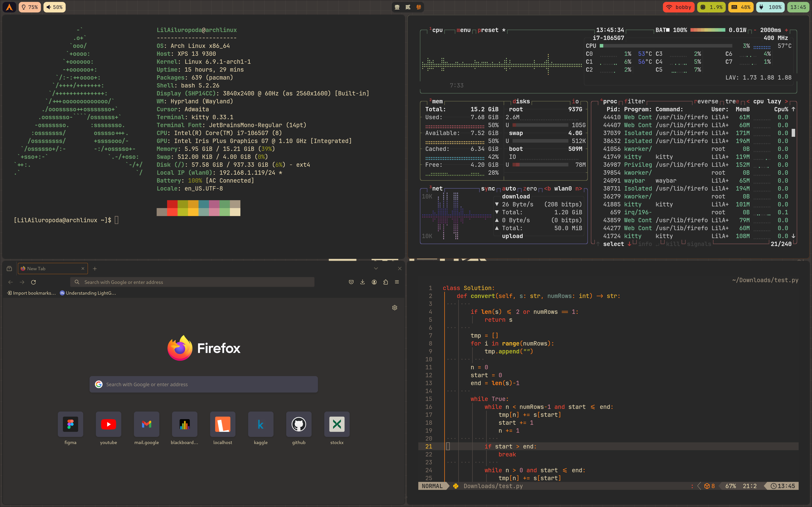
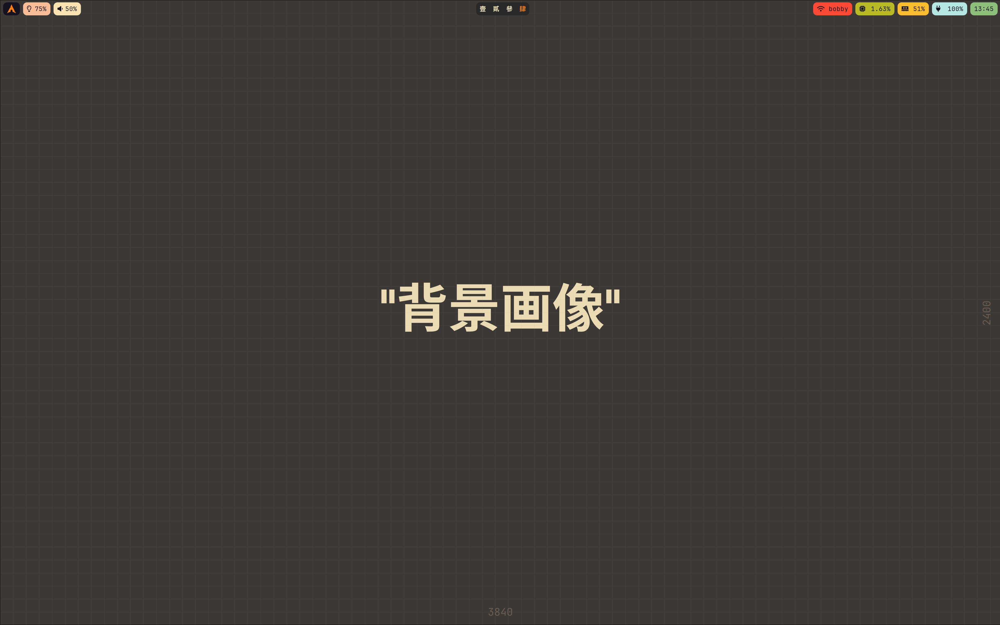

<div align="center">

# Dotfiles

**A minimal, keyboard-driven Arch Linux + Hyprland desktop.**

[](https://archlinux.org)
[](https://hypr.land)
[](https://github.com/Alexays/Waybar)
[](https://github.com/LazyVim/LazyVim)
[](https://github.com/morhetz/gruvbox)
[](https://www.lua.org)
[](LICENSE)

</div>

---

Personal dotfiles for my Arch Linux + Hyprland laptop, versioned as a single Git repository rooted at `~/.config`. The repository is intentionally scoped to the desktop customization — Hyprland, Waybar, Rofi, Dunst, terminals, Neovim, KDE applications, and visual theming — while application data, caches, and credentials are excluded via `.gitignore`.

## Preview

<div align="center">
  
  
</div>

## Stack

| Category | Tool |
| --- | --- |
| **Window manager** | [Hyprland](https://hypr.land) — Lua configuration |
| **Status bar** | [Waybar](https://github.com/Alexays/Waybar) |
| **Launcher** | [Rofi](https://github.com/davatorium/rofi) — [adi1090x](https://github.com/adi1090x/rofi) themes |
| **Notifications** | [Dunst](https://dunst-project.org) |
| **Terminals** | [Kitty](https://sw.kovidgoyal.net/kitty/) (primary), [Foot](https://codeberg.org/dnkl/foot) |
| **Shell prompt** | [Starship](https://starship.rs) |
| **Editors** | [Neovim](https://neovim.io) (LazyVim), [Kate](https://kate-editor.org) |
| **File managers** | [Dolphin](https://apps.kde.org/dolphin/), [Ranger](https://github.com/ranger/ranger) (keybind) |
| **Session menu** | [wlogout](https://github.com/ArtsyMacaw/wlogout) |
| **Wallpaper** | [hyprpaper](https://github.com/hyprwm/hyprpaper) |
| **Display profiles** | [Kanshi](https://sr.ht/~emersion/kanshi/) |
| **System info** | [fastfetch](https://github.com/fastfetch-cli/fastfetch), [btop](https://github.com/aristocratos/btop), [Cava](https://github.com/karlstav/cava) |
| **Theme** | Gruvbox Dark |
| **Font** | JetBrains Mono Nerd Font |

## Repository layout

```text
~/.config
├── .gitignore            # Whitelist of tracked customization folders
├── hypr/                 # Hyprland configuration (Lua modules)
│   ├── hyprland.lua      # Entry point
│   └── modules/          # binds, env, general, input, monitors, rules, startup
├── waybar/               # Status bar config and stylesheet
├── rofi/                 # Launchers, applets, power menus, and color themes
├── dunst/                # Notification daemon
├── kitty/                # Primary terminal + Gruvbox theme
├── foot/                 # Lightweight fallback terminal
├── nvim/                 # Neovim configuration (LazyVim)
├── KDE/                  # KDE application settings
├── kate/                 # Kate external tools
├── katerc                # Kate configuration
├── kwriterc              # KWrite configuration
├── dolphinrc             # Dolphin file manager settings
├── wlogout/              # Session/power menu
├── kanshi/               # Monitor profiles
├── btop/                 # Resource monitor
├── cava/                 # Audio visualizer
├── fastfetch/            # System fetch
├── starship.toml         # Shell prompt
├── wallpapers/           # Wallpapers (see note below)
├── screenshots/          # Desktop previews
├── README.md             # This file
├── LICENSE               # MIT License
└── backup-dotfiles.sh    # Backup helper
```

## Keybindings

`SUPER` is the main modifier.

| Binding | Action |
| --- | --- |
| `SUPER + Return` | Open terminal (Kitty) |
| `SUPER + Space` | Application launcher (Rofi) |
| `SUPER + B` | Open browser (Firefox) |
| `SUPER + E` | File manager (Ranger) |
| `SUPER + Q` | Close active window |
| `SUPER + F` | Toggle fullscreen |
| `SUPER + V` | Toggle floating |
| `SUPER + P` | Toggle pseudotiling |
| `SUPER + M` | Session menu (wlogout) |
| `SUPER + 1` … `SUPER + 0` | Switch to workspace 1–10 |
| `SUPER + Scroll Up/Down` | Cycle workspaces |
| `SUPER + Shift + S` | Screenshot region to clipboard |
| `SUPER + LMB / RMB` | Drag / resize window |
| `XF86Audio*` | Volume up, down, mute |
| `XF86MonBrightness*` | Brightness up, down |

## Installation

> **Warning:** These are personal configurations tied to specific hardware. Back up your existing setup before applying them.

```bash
# 1. Back up the current configuration
mv ~/.config ~/.config.bak

# 2. Clone the repository directly into ~/.config
git clone https://github.com/jam3sl1ng/dotfiles.git ~/.config

# 3. Make the wallpapers available where hyprpaper expects them
mkdir -p ~/Pictures
cp -r ~/.config/wallpapers ~/Pictures/
```

Log out and back in to apply the new configuration.

### Dependencies

Core packages (Arch Linux):

```bash
sudo pacman -S --needed \
  hyprland hyprpaper waybar dunst rofi kanshi \
  kitty foot starship neovim btop fastfetch cava \
  kate dolphin ranger firefox \
  brightnessctl wireplumber networkmanager alsa-utils \
  grim slurp wl-clipboard polkit-kde-agent qt5ct \
  ttf-jetbrains-mono-nerd papirus-icon-theme
```

A few extras used by the configuration are available from the AUR:

```bash
yay -S --needed wlogout light
```

## Theming

The desktop follows a consistent **Gruvbox Dark** palette across Hyprland borders, Kitty, Dunst, Waybar, Rofi, and Neovim. Kate and Dolphin also use the Gruvbox color scheme. UI text is rendered in **JetBrains Mono Nerd Font** at 16 px.

Hyprland is configured with 4 px inner / 8 px outer gaps, 8 px window rounding, 1 px borders, no blur, and the Dwindle layout.

## Backup workflow

`backup-dotfiles.sh` stages every non-ignored change under `~/.config`, commits it with the current date, and pushes to the remote:

```bash
./backup-dotfiles.sh
```

## Notes

- `hypr/modules/monitors.lua` is tailored to the built-in `eDP-1` display (`3840x2160@60`, scale `1.67`). Adjust it for your own hardware.
- `hypr/hyprpaper.conf` loads wallpapers from `~/Pictures/wallpapers/`, hence the copy step during installation.
- `.gitignore` uses a whitelist: only the desktop customization folders listed above are tracked. Android Studio, browsers, other application data, caches, logs, session state, and credentials are ignored automatically.

## Credits

- [Hyprland](https://hypr.land) and the wider Hypr ecosystem
- [adi1090x/rofi](https://github.com/adi1090x/rofi) for the Rofi launcher and power-menu themes
- [LazyVim](https://github.com/LazyVim/LazyVim) as the Neovim foundation
- [Gruvbox](https://github.com/morhetz/gruvbox) by Pavel Pertsev

## License

Released under the [MIT License](LICENSE). You are free to use, modify, and distribute these configurations, provided the copyright notice is retained.
